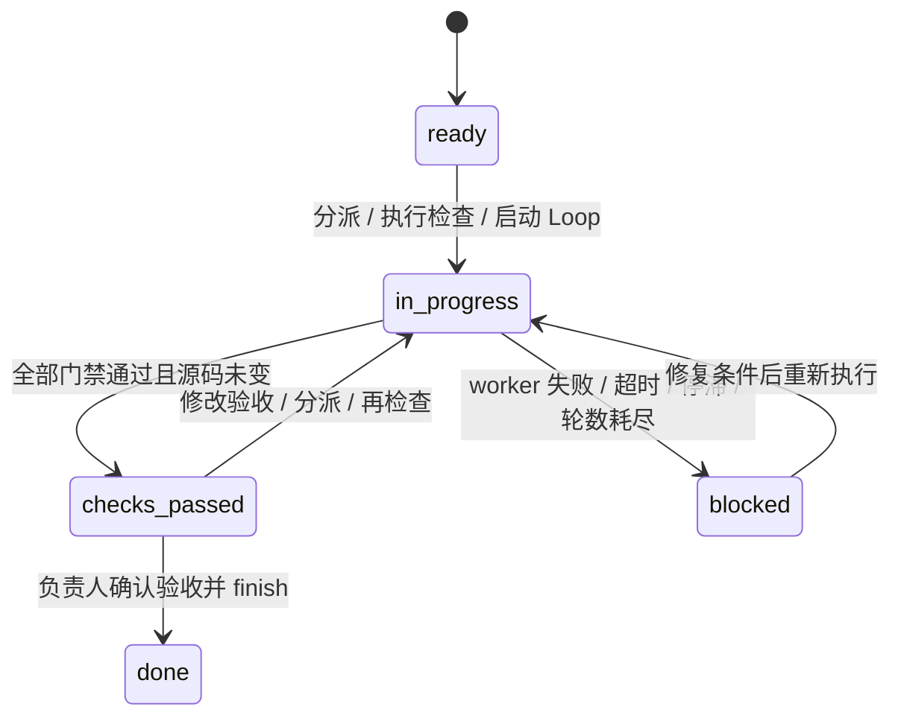

# 工程设计与约束

## Harness：共享协议，按需加载

工具入口只包含版本和导航。项目上下文、角色、工作流、具体任务分开保存，避免大段固定提示词挤占上下文。优先沿用存量项目约定，不自动建立不适用的项目技术栈配置。

`templates.py` 负责协议与适配内容，`install.py` 负责受管内容合并和版本，`storage.py` 负责路径、锁、原子替换与备份，`tasks.py` 负责状态和执行，`cli.py` 提供稳定的脚本接口。所有已安装运行时代码一起纳入 manifest。

`init`/`upgrade --dry-run` 输出实际将改动的文件，不创建目标目录。安装与升级先完成全量冲突检查，再保存变更前快照；单文件原子替换，进程内异常时回滚。整个安装不是跨文件系统事务；若掉电或被强杀，请用备份核查和恢复部分写入。不要把目录锁误解为文件系统事务或访问控制。

项目写操作使用 `.harness/.lock/` 独占锁，锁中记录 PID 和 UTC 时间。强杀后锁可能残留；确认对应进程已经结束后手动删除 `.harness/.lock` 再操作。读命令不加锁，升级过程中应等待升级结束后读取以取得稳定快照。

## Loop：真实验证与有限资源

状态的主要流转为：

每轮先把诊断输出写入 prompt，再执行 worker；worker 非零退出或超时即停止，不用成功的 gate 掩盖 worker 失败。worker 成功后运行所有 gate，并保存退出码、时长和日志。只有所有 gate 返回 0，且执行前后源码及验收输入未变化，检查才通过。

停滞检测比较连续失败轮次的源码/配置/任务证据指纹及 gate 退出状态。`stagnation_rounds: 2` 表示在第一个观察点之后连续两次相同，通常在第 3 轮停止。日志噪声和时间戳不会被当作进展。配置、任务结构和执行命令应由可信项目负责人维护。

worker 每轮超时；gate 各有超时；最多 100 轮。最坏时长约为 `rounds × (worker_timeout + 所有 gate_timeout 之和)` 加上 I/O 开销。它不限制模型 token、费用、磁盘占用或经外部服务发起的后台作业。不要使用 daemonizing worker。

POSIX 上超时/中断会终止当前命令所在进程组；Windows 上 Python 标准库实现仅保证终止直接子进程，项目需要更强进程树回收时应使用自身 runner 或 Job Object 封装。Loop 运行期间父进程持有项目锁，worker 不应嵌套执行会写状态的 harness 命令。

## 检查证据的有效期

源码指纹读取文件内容，不依赖 mtime；遍历不跟随符号链接。排除 `.git`、`.harness`、node_modules、虚拟环境、缓存、常见构建和覆盖率目录。配置、项目上下文及任务中人工编写的交付文件单独加入指纹，排除 task.json、runs 和 delivery.md。源码范围内的 symlink 使用链接目标文本计算指纹。

`finish` 要求非空验收标准、最近检查通过、指纹未变化、子任务全部 collect 且结果哈希相符，并由调用方确认业务验收。该机制用于避免意外使用旧检查证据；它不是安全沙箱，也无法判断人类填写的验收是否合理。

外部数据库、环境变量、依赖目录、远程接口和源码排除目录里的变化不会自动进入指纹。它们需要由项目门禁固定版本或重新验证。标准检查应使用只读测试或将构建输出写到排除目录；自动格式化修改源文件会导致本轮检查拒绝通过，需要重新 check。

## 子 Agent 的责任边界

任务图只允许依赖已存在子任务，因此通过正常命令创建时不会产生循环依赖。collect 需要依赖已经收集，结果有实际内容；成果质量由主 Agent 判断。scope 是协作所有权说明，不是系统权限限制。

使用原生 Agent 时由 Claude Code / OpenCode / 当前 Codex 会话完成调度；其他场景采用独立会话或串行角色切换。这个版本不提供跨供应商统一的进程级并发调度器，也不自动创建或合并业务 worktree。
